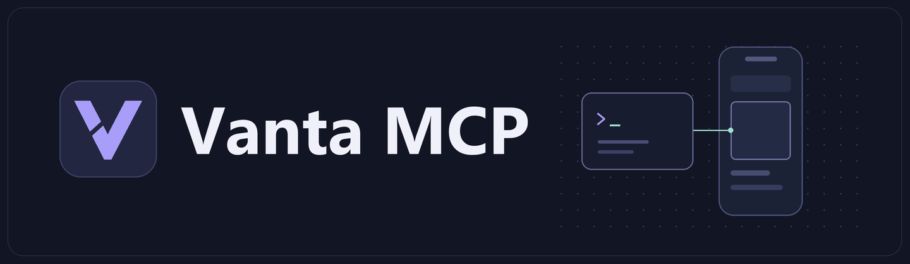
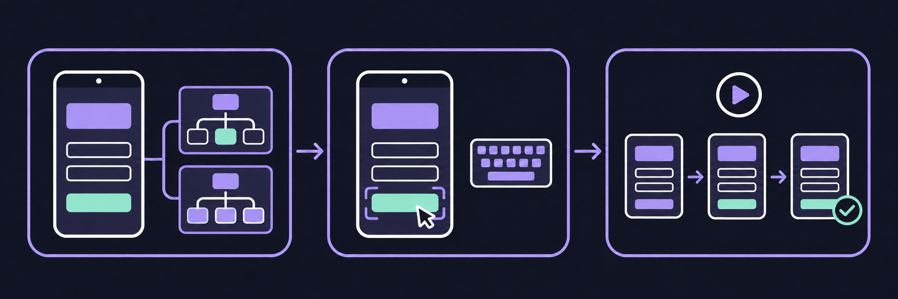
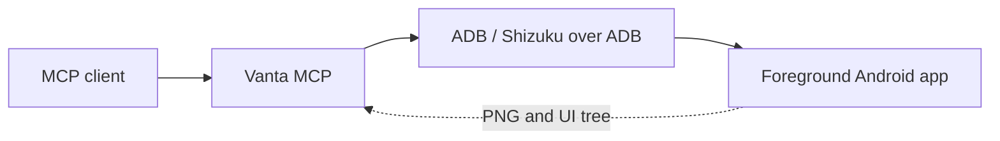
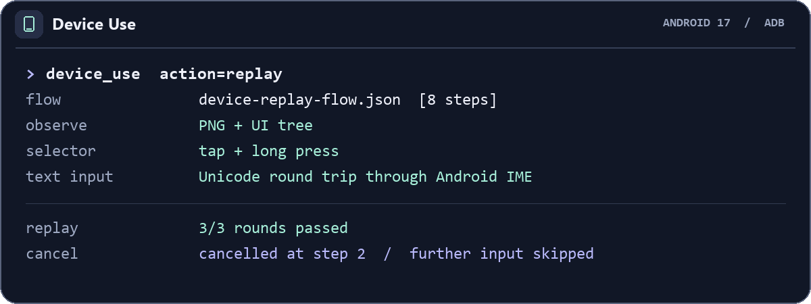
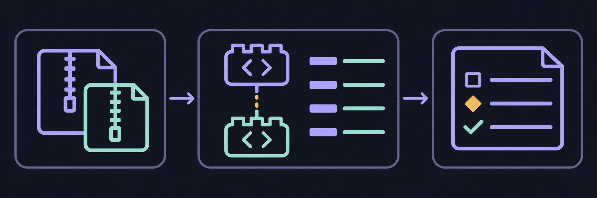
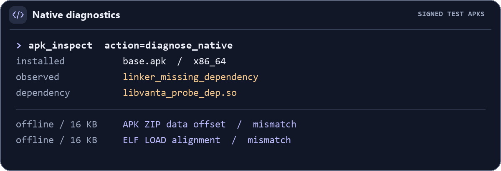

# Vanta MCP



By [Volsa](https://github.com/SVolsa) · [简体中文](README.zh-CN.md) · [MIT](LICENSE)

Vanta MCP is a local server for Android device control, UI regression testing, and artifact inspection. **Device Use** pairs screenshots with the foreground UI tree and runs repeatable interaction flows.

[Quick start](#quick-start) · [Device Use](#device-use) · [Native load failures](#native-load-failures) · [Verification](#verification)

## Quick start

Install Node.js 22 or 24 and Android Platform Tools. Put `adb` on PATH or set `ADB_PATH`. Enable USB debugging and approve the host connection. [Android SDK Platform Tools](https://developer.android.com/tools/releases/platform-tools)

### Agent Prompt

Copy this block into your local agent. Attach the source ZIP or the `.tgz` package if available.

```text
Install Vanta MCP by Volsa (https://github.com/SVolsa) in my current MCP client.
Use the supplied vanta-mcp-0.11.0.tgz with npm exec or the supplied source ZIP.
If using the source ZIP, extract it, run npm ci --ignore-scripts, and register
node with the absolute path to server.js. Otherwise, check npm for the
Volsa release of vanta-mcp@0.11.0 and use npx --yes --ignore-scripts vanta-mcp@0.11.0.
Keep existing MCP entries. Register Vanta as a stdio server named vanta.
Check Node.js and run adb devices -l. Use the authorized device I specify.
Set VANTA_TRANSPORT=adb, VANTA_SERIAL to that device, and ADB_PATH if needed.
Reconnect the client. Verify that Vanta exposes device_use and apk_inspect,
then run connection(check) with shell privileges. Report the result and any
manual step still required. Leave Android app and privilege settings unchanged.
```

### npm package

Use this stdio command for the npm registry release.

```sh
npx --yes --ignore-scripts vanta-mcp@0.11.0
```

For a local tarball, use `npx --yes --ignore-scripts --package /absolute/path/to/vanta-mcp-0.11.0.tgz vanta-mcp`. Run these commands outside the Vanta MCP source tree.

The server waits for MCP requests on stdin. Set the device and transport in the client's environment settings. npm installs the host server. Use the source archive to build the optional Android input method and test APKs. [npm exec reference](https://docs.npmjs.com/cli/commands/npm-exec/)

### Source archive

```sh
npm ci --ignore-scripts
adb devices -l
```

Register a local stdio server. Replace the path and serial and escape backslashes in Windows JSON paths.

```json
{
  "mcpServers": {
    "vanta": {
      "command": "node",
      "args": ["/absolute/path/to/vanta-mcp/server.js"],
      "env": {
        "VANTA_TRANSPORT": "adb",
        "VANTA_SERIAL": "emulator-5554"
      }
    }
  }
}
```

## Supported workflows

| Use case | Common tasks |
| --- | --- |
| Android reverse engineering | Export base and split APKs, compare DEX and native libraries, inspect ELF dependencies and disassembly, and compare existing VM traces |
| Android app development | Replay UI flows, collect crashes, and check native dependencies, ABI, and 16 KB alignment |
| Android root administration | Inspect processes, threads, memory mappings, logs, and module state on an authorized device |
| Android kernel module development | Check a `.ko` file's architecture, vermagic, dependencies, and symbol CRCs against a target kernel build |

## Device Use



*Observe the foreground app, target a control, and verify a repeatable flow.*

Unlock the test device and bring the app to the foreground. Call `device_use` with `action=open`, the package name, and the ADB serial. Save the returned `session`.



| Action | What it does |
| --- | --- |
| `observe` | Returns the PNG screenshot, UI tree, and `frame`. Set `image=false` or `tree=false` to omit either part. |
| `perform` | Takes the session, latest frame, and a single step. Supports selector or coordinate taps, double taps, long presses, swipes, drags, key presses, and text input. |
| `replay` | Runs an inline `flow` or a host-side JSON `flow_file`. Checks the app and controls before each step and writes a step report on failure. |
| `status` / `cancel` | Shows progress or asks the replay to stop before another step. Status also shows the last replay result. |
| `close` | Ends the session. Request cancellation first if a replay is running. |

Use a resource ID when the app exposes one. `tap_selector` and `long_press_selector` also accept exact `text` and `description`. Multiple matches stop the action. Use a current screenshot for coordinate gestures, and set `duration_ms` or `speed_px_s` for swipes and drags.

```json
{"action":"perform","session":"SESSION_ID","frame":"FRAME_ID","step":{"kind":"tap_selector","selector":{"resource_id":"dev.example:id/save"}}}
```

Replays can wait for controls to appear or disappear, assert their presence or absence, tap, long-press, type, send keys, and scroll inside a container to find a control. Start with the [eight-step example](test-app/device-replay-flow.json). A replay stops if the device locks, the app leaves the foreground, or the connection drops. Input already sent to Android may finish after `cancel`.

Reports go to `out/inspection/` for a source checkout and to `~/.vanta-mcp/inspection/` for an npm installation. Set `VANTA_INSPECTION_DIR` to select another directory.

### Device Use verification output



### Unicode and symbols

Build Vanta Device Input with Python 3, JDK 17, Android SDK Platform 35, and Build Tools 36.0.0.

```sh
python build_device_input.py
adb -s YOUR_SERIAL install out/device-input/vanta-device-input.apk
```

Enable and select Vanta Device Input using Android's input method picker, then focus a normal text field. Android's built-in input handles ordinary ASCII by default. Use the picker to switch back when finished.

```json
{"kind":"type","text":"中文 ∑≤∞ 👩‍💻 %s","method":"ime"}
```

## Connection modes

- **ADB** uses the Android shell by default. Set `privilege=root` on a call that needs a root grant already configured on your test device.
- **Shizuku** uses the official service over ADB. Start the service and copy the exported `rish` and `rish_shizuku.dex` to the same directory on the device. Set `VANTA_RISH_PATH` to the device path and `VANTA_RISH_APPLICATION_ID` to the caller (`com.android.shell` for ordinary ADB). Android 14 and later require a read-only DEX. Use `connection` with `action=check` and `privilege=shizuku` to verify `rish_verified` and the execution UID. [Upstream rish documentation](https://github.com/RikkaApps/Shizuku-API/tree/master/rish)
- **Paired USB** is available for Windows and ARM64 Android test devices with KernelSU Next. [USB bridge setup](docs/usb-bridge.md)

## Native load failures



*Inspect the APK set, check native libraries, and locate the affected entry in the report.*

Use `apk_inspect` with `action=diagnose_native` when a library fails to load. For an installed app, pass the package name. Vanta checks its split APKs against the device ABI and page size and looks for a linker error from the installed build. For offline inspection, pass `apks` and optionally set `abi` and `page_size`.

```json
{"action":"diagnose_native","apks":["base.apk","split_config.arm64_v8a.apk"],"abi":"arm64-v8a","page_size":16384}
```

The report identifies the APK and library affected by an ABI mismatch, unaligned ZIP entry, or unaligned ELF load segment. An `observed` finding includes the linker log. A dependency absent from the supplied APKs is marked `review`. APK inspection requires Python 3, Java, and Android Build Tools. ELF inspection uses the Android NDK LLVM tools. Set `JAVA_HOME` and `ANDROID_NDK_HOME` if the tools are outside the standard SDK paths.

### Native diagnostics verification output



## Compare APK manifests

Run `apk_inspect` with `action=inspect` on each version’s base and split APKs. Pass the two resulting `inventory.json` paths as `left` and `right` to `action=compare`.

`comparison.json` reports the changed declarations by split under `manifest_delta`. The comparison covers SDK levels, requested and declared permissions, component export and permission attributes, and intent filter actions, categories and direct `<data>` rules. The report records manifest declarations. Reinspect either APK set if its inventory reports `insufficient_inventory`.

## Process and kernel diagnostics

Set `forensics: true` on `run` to record the child PID, start tick, host duration and exit receipt. Pass arguments in `argv`. When the shell status is shared by a normal exit and a signal, Vanta reports `ambiguous` with the original status.

`kernel_snapshot` requires explicit `privilege: "root"`. It records the boot identity, dmesg and available pstore files. The report records each source's status and hashes saved bytes.

`kernel_record` requires explicit `privilege: "root"`. Pass a local `.ko` to record its identity and the current module state. The `load` and `unload` flags request device changes. For a load, pass module parameters as individual `name=value` entries in the `params` array. The final snapshot follows the last requested action.

## Verification

```sh
npm test
go -C device test ./...
go -C device vet ./...
python build_inspection_probe.py --abi arm64-v8a
```

On Windows, the shell and file transfer tests use Git for Windows. Set `VANTA_TEST_SHELL` if its shell is outside the standard location.

For replay on an unlocked test device, install and select Vanta Device Input, then pass the APK path printed by the probe builder. Use the ABI of the test device. Append `--shizuku` for a configured Shizuku connection.

```sh
node verify_device_replay.mjs YOUR_SERIAL /absolute/path/to/probe/base.apk
```

For the native diagnostic, build four signed x86_64 APK sets, then pass the four output directories to the verifier with the serial of a disposable x86_64 emulator.

```sh
python build_inspection_probe.py --abi x86_64 --native-variant good
python build_inspection_probe.py --abi x86_64 --native-variant missing-dependency
python build_inspection_probe.py --abi x86_64 --native-variant wrong-abi
python build_inspection_probe.py --abi x86_64 --native-variant misaligned
node verify_native_diagnosis.mjs EMULATOR_SERIAL GOOD_DIR MISSING_DIR WRONG_ABI_DIR MISALIGNED_DIR
```

The Android 17 emulator passed three runs each with ordinary ADB and Shizuku 13.6.0 in shell mode. Both connections passed cancellation during a wait. The native verifier checks 16 KB alignment offline and reproduces a missing dependency on the emulator. Physical-device kernel diagnostics, foreground replay, Shizuku app-level permission revocation, and paired USB replay still need verification.
