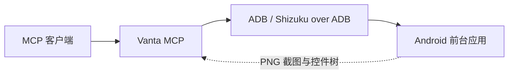
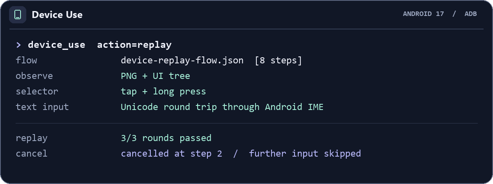
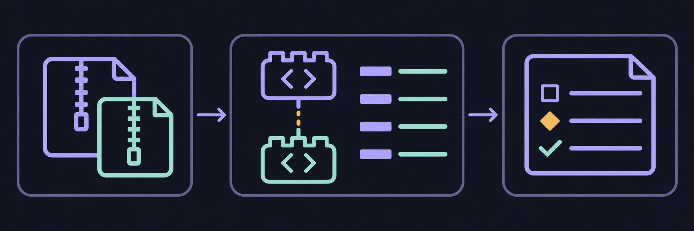
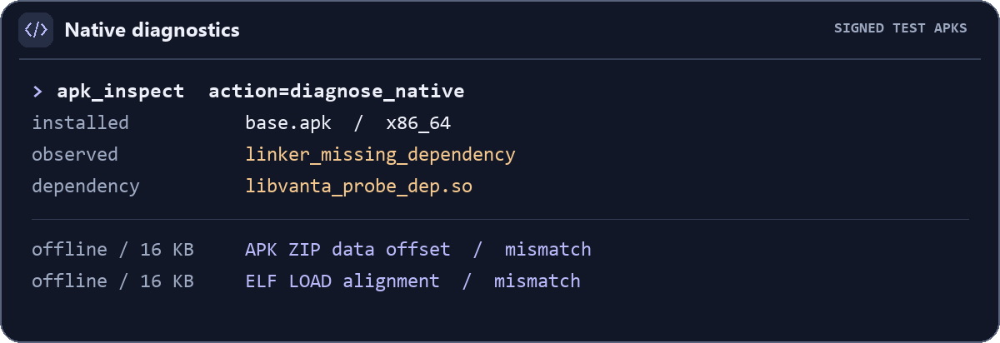

# Vanta MCP


作者 [Volsa](https://github.com/SVolsa) · [English](README.md) · [MIT](LICENSE)

Vanta MCP 是用于 Android 设备操作、界面回归和制品分析的本地服务。**Device Use** 提供前台截图、控件定位、字符输入和交互回放，便于复验不同构建的界面行为。

[快速启动](#快速启动) · [Device Use](#device-use) · [Native 加载失败](#native-加载失败) · [验证](#验证)

## 快速启动

安装 Node.js 22 或 24 和 Android Platform Tools。启用 USB 调试并在设备上确认主机授权。将 `adb` 加入 PATH，或设置 `ADB_PATH`。[Android SDK Platform Tools](https://developer.android.com/tools/releases/platform-tools)

### Agent Prompt

复制下方指令给本地 Agent。如已下载源码 ZIP 或 `.tgz`，一并提供给 Agent。

```text
请在当前 MCP 客户端安装 Volsa（https://github.com/SVolsa）维护的 Vanta MCP。
优先使用我提供的 vanta-mcp-0.11.0.tgz，通过 npm exec 启动。
如果我提供的是源码 ZIP，请解压，执行 npm ci --ignore-scripts，
用 node 和 server.js 的绝对路径启动。如未提供安装包，请在 npm 核对 Volsa 发布的
vanta-mcp@0.11.0，再用 npx --yes --ignore-scripts vanta-mcp@0.11.0 启动。
保留现有 MCP 配置，新增名为 vanta 的 stdio 服务。
检查 Node.js，运行 adb devices -l，使用我指定的已授权设备。
设置 VANTA_TRANSPORT=adb、VANTA_SERIAL 为该设备序列号，必要时设置 ADB_PATH。
重连客户端，确认已加载 device_use 和 apk_inspect，再以 shell 权限运行 connection(check)。
报告连接结果和仍需我手动完成的步骤，保持 Android 应用与授权设置原样。
```

### npm 安装包

从 npm registry 按版本启动。

```sh
npx --yes --ignore-scripts vanta-mcp@0.11.0
```

本地包使用 `npx --yes --ignore-scripts --package /absolute/path/to/vanta-mcp-0.11.0.tgz vanta-mcp`。请在 Vanta MCP 源码目录之外运行这些命令。

将启动命令填入客户端的 stdio 服务配置。npm 安装的是主机服务，构建 Android 输入法和验收 APK 使用源码包。[npm exec 文档](https://docs.npmjs.com/cli/commands/npm-exec/)

### 从源码安装

```sh
npm ci --ignore-scripts
adb devices -l
```

在 MCP 客户端添加 stdio 服务，命令填 `node`，参数填 `server.js` 的绝对路径。设置 `VANTA_TRANSPORT=adb` 和 `VANTA_SERIAL`。[英文配置示例](README.md#source-archive)

## 适用场景

| 用途 | 常用操作 |
| --- | --- |
| Android 逆向工程 | 导出 base/split APK，比较 DEX 和 `.so`，查看 ELF 依赖、重定位和反汇编，比对已有 VM 轨迹 |
| Android 软件开发 | 回放界面流程，定位崩溃，检查 Native 依赖、ABI 和 16 KB 对齐 |
| Android Root 管理 | 在已授权设备上查看进程、线程、内存映射、日志和模块状态 |
| Android 内核模块开发 | 检查 `.ko` 的架构、vermagic、依赖和符号 CRC，和目标内核构建对照 |

## Device Use


*观察应用前台，定位并操作控件，回放流程后核对结果。*

先解锁设备并打开要操作的 App。调用 `device_use` 的 `open`，传入包名和 ADB 序列号。保存返回的 `session`。



| 操作 | 用法 |
| --- | --- |
| `observe` | 返回 PNG、当前 App 的控件树和 `frame`。可用 `image=false` 或 `tree=false` 只取需要的内容。 |
| `perform` | 传入 `session`、最近的 `frame` 和一个 `step`。支持控件点击、坐标点击、双击、长按、滑动、拖动、按键和输入字符。 |
| `replay` | 传入 `session` 和 `flow` 或 `flow_file`。每步重新检查前台和控件，失败时写步骤报告。 |
| `status` / `cancel` | 回放时查当前步和总步数，或请求停止后续输入。结束后可查最近一次回放报告。 |
| `close` | 结束当前会话。运行中的回放可以先 `cancel`。 |

优先用控件资源 ID。`tap_selector`、`long_press_selector` 也接受精确的 `text` 和 `description`。匹配多个控件时操作会停止。坐标操作需要最新截图。滑动和拖动可指定 `duration_ms` 或 `speed_px_s`。

```json
{"action":"perform","session":"SESSION_ID","frame":"FRAME_ID","step":{"kind":"tap_selector","selector":{"resource_id":"dev.example:id/save"}}}
```

回放支持等待控件出现或消失、断言存在或消失、点击、长按、键盘输入以及在指定容器内滚动查找。可以从 [八步示例](test-app/device-replay-flow.json) 开始。切后台、锁屏或连接中断会终止回放。`cancel` 停止后续步骤，已交给 Android 的输入仍可能完成。

源码运行时，报告写入 `out/inspection/`。通过 npm 启动时，报告写入 `~/.vanta-mcp/inspection/`。可用 `VANTA_INSPECTION_DIR` 指定输出目录。

### Device Use 验收输出



### Unicode 字符输入

在源码目录使用 Python 3、JDK 17、Android SDK Platform 35 和 Build Tools 36.0.0 构建 Vanta Device Input。

```sh
python build_device_input.py
adb -s YOUR_SERIAL install out/device-input/vanta-device-input.apk
```

在 Android 输入法选择器启用并切到 Vanta Device Input，聚焦普通文本框。普通 ASCII 默认可用系统键盘路径，测试完可在输入法面板切回原键盘。

```json
{"kind":"type","text":"中文 ∑≤∞ 👩‍💻 %s","method":"ime"}
```

## 连接方式

- **ADB** 默认用 shell。需要 root 的操作在调用中显式指定 `privilege=root`，设备需要已经授予 root 权限。
- **Shizuku** 先按官方 App 启动服务，导出 `rish` 和 `rish_shizuku.dex` 并复制到设备上的同一目录。设置 `VANTA_RISH_PATH`。普通 ADB shell 的 `VANTA_RISH_APPLICATION_ID` 为 `com.android.shell`。Android 14 起，DEX 须只读。调用 `connection` 的 `check` 并选 `privilege=shizuku`，核对 `rish_verified` 和实际 UID。 [官方 rish 文档](https://github.com/RikkaApps/Shizuku-API/tree/master/rish)
- **配对 USB** 用于 Windows 和 ARM64 Android 上已配置 KernelSU Next 的测试设备。 [配对步骤](docs/usb-bridge.md)

## Native 加载失败



*读取 APK 集，核对 Native 库，在报告中定位受影响的条目。*

如果应用启动时报 `dlopen failed`，用 `apk_inspect` 的 `diagnose_native`。传包名时按设备当前 ABI 和页大小分析已安装的 split，并尝试从此版本的崩溃日志核对缺库。离线时传 `apks`，可用 `abi` 和 `page_size` 指定测试目标。

```json
{"action":"diagnose_native","transport":"adb","serial":"YOUR_SERIAL","package":"dev.example"}
```

报告列出有问题的 APK 和 `.so`，分别标记 ABI 错配、ZIP 条目未对齐和 ELF 加载段未对齐。`observed` 附实际链接器日志。仅在 APK 中未找到依赖时标为 `review`。APK 检查依赖 Python 3、Java 和 Android Build Tools，ELF 检查依赖 NDK LLVM 工具。工具安装在非标准位置时，可设置 `JAVA_HOME` 和 `ANDROID_NDK_HOME`。

### Native 诊断验收输出



## 比较 APK Manifest

分别用 `apk_inspect` 的 `inspect` 检查两个版本的 base 和 split APK，再把两份 `inventory.json` 作为 `left` 和 `right` 传给 `compare`。

`comparison.json` 的 `manifest_delta` 按 split 列出 SDK 级别、申请和声明的权限、组件导出及权限属性，以及 Intent Filter 的 action、category 和直接声明的 `<data>` 条件。报告以 Manifest 声明为准。遇到 `insufficient_inventory` 时，可重新检查缺少 Manifest 数据的 APK。

## 进程与内核取证

在 `run` 中设置 `forensics: true`。命令参数通过 `argv` 传入。报告记录子进程 PID、启动 tick、主机耗时和退出收据。退出与信号共用同一个 shell 状态时，报告保留原值并标记 `ambiguous`。

`kernel_snapshot` 要求显式设置 `privilege: "root"`。报告记录设备启动身份以及 dmesg 和 pstore 各自的读取结果。已保存内容附 SHA-256。

`kernel_record` 要求显式设置 `privilege: "root"`。传入本地 `.ko` 可记录模块身份和状态。调用方用 `load` 和 `unload` 明确请求设备变更。用 `params` 数组逐项传入 `name=value` 参数。报告在最后一次请求的操作完成后采集最终状态。

## 验证

```sh
npm test
go -C device test ./...
```

Android 17 模拟器的普通 ADB 与 Shizuku 13.6.0 shell 模式各通过三轮回放，两个连接均通过等待期间取消的用例。Native 验证离线检查 16 KB 对齐，并在模拟器上复现缺库错误。实体机取证、前台回放、Shizuku 应用级撤销和配对 USB 回放待验。[复验步骤](README.md#verification)
